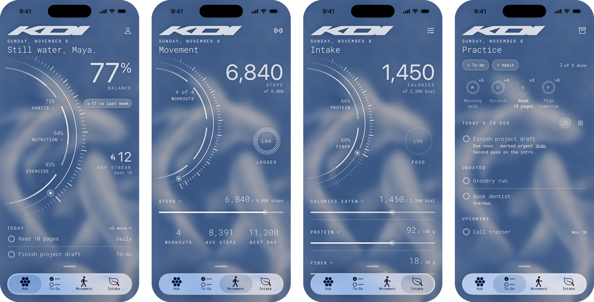
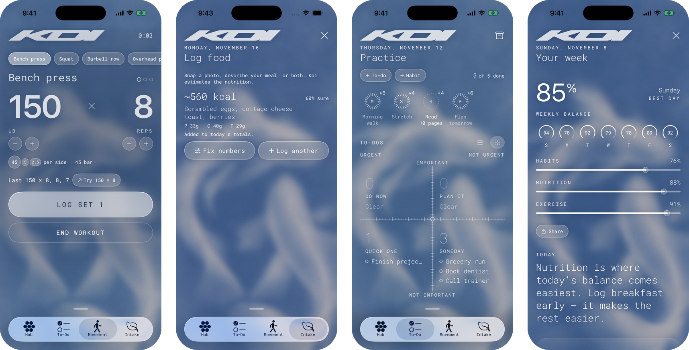
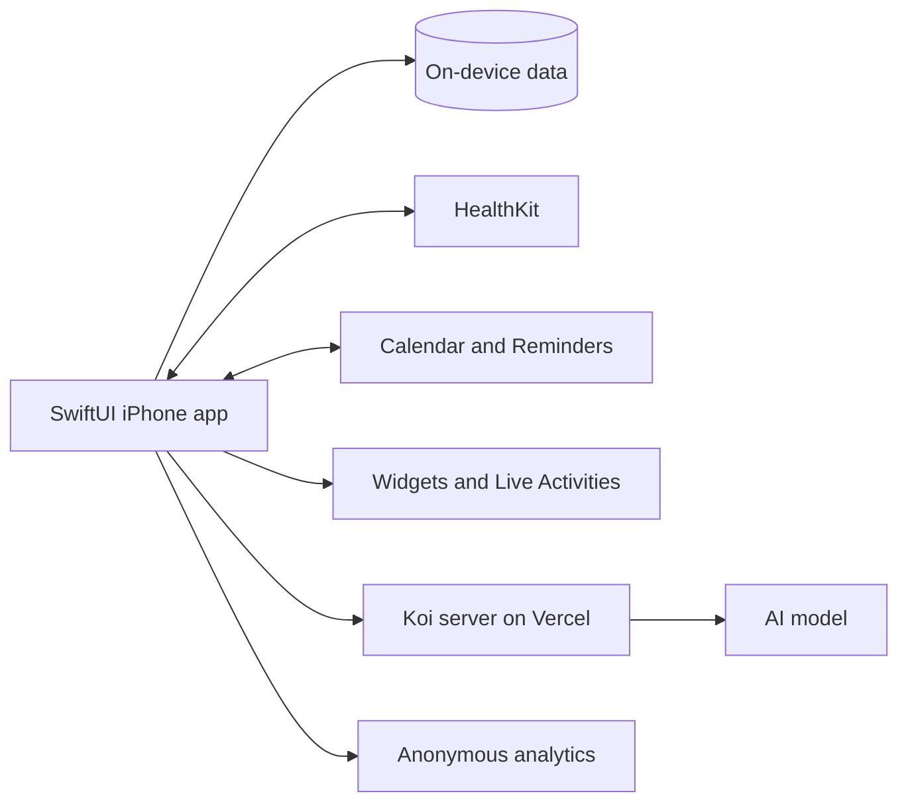

# Koi

**The bridge between intent and action.** Koi is an iPhone app that brings habits, nutrition, exercise, to-dos and calendar into one daily Balance score, so one glance tells you whether you're on track or slipping.

**[balancewithkoi.app](https://balancewithkoi.app)** · TestFlight beta · App Store launch planned January 1, 2027

> This is a product overview. Koi is headed to the App Store, so the source is in a private repository. I'm happy to walk through it on request.

## The problem

I was using six apps to run my day, and none could answer the one question that mattered: am I on track? We surveyed 47 people, and 46 said they feel overwhelmed balancing everything.

## What it does

| | |
|---|---|
| **One score** | Habits, nutrition and exercise roll into a single Balance, weighted to your focus |
| **AI food logging** | Snap or describe a meal, get calories and macros with a confidence level |
| **Training** | Live workouts and runs, supersets, trends, and importing a plan from a screenshot |
| **Readiness** | Ready, Steady or Take it easy, from sleep, HRV and resting heart rate |
| **Your day** | To-dos in a priority matrix, with two-way Apple Reminders and calendar sync |
| **Smart notes** | Write one sentence and Koi offers the to-do, meal or workout inside it |

## Traction

**51** beta testers (November 2026)

**2,678** sessions · **170** AI meal logs in 30 days, about **25** daily users (TelemetryDeck, November 2026)

- Reached beta build 28 about 14 weeks after the first commit
- Startup Launch Award finalist, CPVC AI Hackathon (Cal Poly, Nov 2026), with a separate version built that weekend
- Pitched live at EconAlliance, Nov 2026

## How it's built

- **Keys stay off the phone.** AI requests go through Koi's own server, with per-device and global daily caps to control cost.
- **About 26,000 lines of Swift**, with 77 automated tests.
- **AI-assisted development.** I lead product, design, testing and releases, and use AI coding tools to write much of the code.

## What I learned

- **Shorter wins.** I cut onboarding from 16 steps to 7 and now record each step to see where people stop.
- **Engagement isn't intent.** 51 people answered an Instagram poll; 9 signed up from Instagram.
- **Measure the feedback.** Testers said text was hard to read, so I measured 80 pieces of on-screen text: 43 fell below the contrast guideline. A redesign cuts that to about 18, and isn't released to testers yet.

---
Built by [Alexander Tarica](https://alexandertarica.com), with collaborators on research and marketing.

© 2026 Alexander Tarica. All rights reserved.
